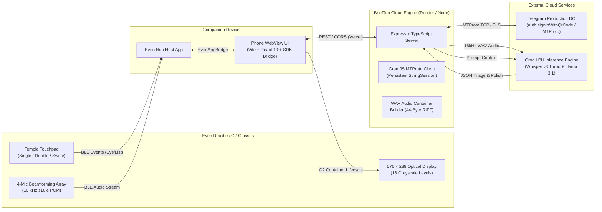

# BriefTap ⚡
### Telegram 10-Second Action Queue for Even Realities G2 Smart Glasses
**Even Realities Global Hackathon — Track 01: Messaging & News (Best Telegram Integration)**

[](https://hub.evenrealities.com)
[](https://core.telegram.org/mtproto)
[](https://groq.com)
[](#)

---

## 💡 The Problem & The Solution

### The Problem: Notification Fatigue on Wearables
Telegram users receive hundreds of noisy messages, mentions, and channel updates every hour. When wearing optical smart glasses, traditional smartwatch-style notifications create a firehose of distraction that ruins line-of-sight focus. Users are forced to constantly reach into their pockets for their smartphone just to send a two-word reply or triage group chatter.

### The BriefTap Solution: 10-Second "Read → Decide → 1-Tap Write"
**BriefTap** turns Telegram into an ambient, high-signal decision queue designed specifically for the **Even Realities G2 576 × 288 monochrome optical display**:
1. **VIP Filtration**: Pulls real unread messages strictly from up to 5 designated VIP contacts or channels.
2. **AI Action Card**: Groq LPU infers the thread context and distills noisy messages into a **1-line decision summary**.
3. **1-Tap Write**: Firmware-rendered list presents 3 contextual, <7-word smart replies. A single tap on the glasses temple touchpad dispatches the reply over Telegram MTProto immediately.
4. **Voice Intent Polish**: When none of the 3 smart replies fit, select `[Mic] Speak intent...`. The G2 4-mic array captures 16 kHz raw PCM audio, transcribes live via `whisper-large-v3-turbo`, and expands a 2-word spoken murmur (e.g. *"approve push 15m"*) into an executive reply via `llama-3.1-8b-instant`.
5. **Channel Alpha Digest**: Distills noisy Telegram alpha channels into 3 high-impact bullets, bookmarkable directly to Telegram **"Saved Messages" (`"me"`)** with a single tap.

---

## 🏗 System Architecture



---

## 🕶 G2 Optical Display Layouts & Touch Gesture Controls

Strictly compliant with Even Realities `glasses-ui`, `design-guidelines`, and `font-measurement` (max 3 containers per page, zero heavy bitmap BLE transmissions):

| Screen | Layout & Containers | Hardware Touchpad Gestures (`handle-input`) |
|---|---|---|
| **1. Action Queue Card** *(Default)* | • **Header (Text, 576×34)**: `FROM: <Sender> (<Chat>) · <Time> [1/N]`<br>• **Summary (Text, 576×72)**: 1–2 crisp decision lines<br>• **Replies (List, 576×174, `isEventCapture: 1`)**: 3 AI smart replies + `[Mic] Speak intent...` | • **Swipe Up / Down**: Native selection cursor<br>• **Single Tap**: 1-Tap Write (sends live reply immediately)<br>• **Double Tap**: Dismiss/skip to next card |
| **2. Voice Intent Capture** | • **Header (Text, 576×36)**: `VOICE INTENT · G2 4-MIC ARRAY`<br>• **Body (Text, 576×244, `isEventCapture: 1`)**: `● RECORDING (16 kHz PCM)...` | • **G2 Mic**: `audioControl(true, AudioInputSource.Glasses)`<br>• **Single Tap**: Stop recording & polish with Groq AI<br>• **Double Tap**: Cancel back to card |
| **3. Voice Reply Confirm** | • **Header (Text, 576×34)**: `CONFIRM REPLY TO <RECIPIENT>`<br>• **Preview (Text, 576×144)**: Spoken transcription vs AI-polished reply<br>• **Controls (Text, 576×96, `isEventCapture: 1`)**: Send / Discard | • **Single Tap**: Send live to Telegram<br>• **Double Tap**: Discard & return to queue |
| **4. Channel Alpha Digest** | • **Header (Text, 576×34)**: `ALPHA DIGEST · <CHANNELS>`<br>• **Body (Text, 576×246, `isEventCapture: 1`)**: 3 real channel bullets | • **Single Tap**: Save bullet to Telegram "Saved Messages"<br>• **Double Tap**: Return to Action Queue |
| **5. Pairing & Empty States** | • `BRIEFTAP · TELEGRAM PAIRING REQUIRED`<br>• `BRIEFTAP · ALL CAUGHT UP (0 unread VIPs)` | • **Double Tap**: Re-check connection / Refresh queue |

---

## 🔒 Security & Privacy Architecture

- **Zero Third-Party Bot Gateway**: Connects via native Telegram MTProto directly to Telegram's production infrastructure as a primary client session.
- **Local Session Persistence**: `StringSession` is encrypted and stored locally in `session.txt` (completely excluded from Git tracking via `.gitignore`).
- **Zero Raw Audio Storage**: G2 microphone audio is buffered in memory, streamed to Groq's high-speed Whisper pipeline, and discarded immediately after transcription.

---

## 🚀 Quickstart & Local Development

### 1. Prerequisites
- Node.js v20+
- Even Realities Developer Simulator: `npm install -g @evenrealities/evenhub-simulator`
- Telegram API Credentials from [my.telegram.org](https://my.telegram.org)
- Free-tier Groq API Key from [console.groq.com](https://console.groq.com)

### 2. Installation
```bash
git clone https://github.com/JimmyOgb/brieftap.git
cd brieftap
npm install
```

### 3. Environment Configuration
Create `apps/server/.env`:
```env
PORT=3001
NODE_ENV=development
TELEGRAM_API_ID=your_api_id_here
TELEGRAM_API_HASH=your_telegram_api_hash_here
GROQ_API_KEY=your_groq_api_key_here
CORS_ORIGIN=http://localhost:5173
```

### 4. Build & Run
```bash
# Typecheck & Build
npm run typecheck
npm run build

# Terminal 1: Backend Server
npm run dev:server

# Terminal 2: Glasses Companion Frontend
npm run dev:glasses
```

### 5. Launch EvenHub Desktop Simulator
```bash
evenhub-simulator http://localhost:5173 --automation-port 9898
```
Open `http://localhost:5173` on your browser or mobile phone, scan the Telegram QR code under the **Telegram Auth** tab, pick your 5 VIP chats, and watch your live unread action queue render on the G2 simulator display!

---

## 🌐 Production Deployment

### 1. Backend (`apps/server`) on Render
The repository includes a ready-to-deploy [`render.yaml`](./render.yaml) Blueprint:
1. Log in to [Render Dashboard](https://dashboard.render.com).
2. Click **New + &gt; Blueprint** and select `JimmyOgb/brieftap`.
3. Fill in the environment variables:
   - `TELEGRAM_API_ID`: Your MTProto API ID
   - `TELEGRAM_API_HASH`: Your MTProto API Hash
   - `GROQ_API_KEY`: Your Groq API key
   - `CORS_ORIGIN`: `https://brieftap.vercel.app`
4. Click **Apply**. Render will build and expose `https://brieftap.onrender.com`.

### 2. Frontend (`apps/glasses`) on Vercel
1. Import repository on [Vercel Dashboard](https://vercel.com).
2. Set Root Directory to `apps/glasses`.
3. Build Command: `npm run build`
4. Output Directory: `dist`
5. Set Environment Variable: `VITE_API_URL=https://brieftap.onrender.com`
6. Deploy! Exposes `https://brieftap.vercel.app`.

---

## 📢 API Feature Requests for Even Realities SDK & Ecosystem

Based on our developer experience building BriefTap under Track 01, here are **5 concrete, high-priority developer-grade feature requests** for the Even Realities G2 SDK and companion ecosystem (submitted for the DoraHacks review team):

### 1. In-Place List Container Updates (`listContainerUpgrade`)
- **Current Limitation**: While `TextContainerProperty` supports flicker-free in-place text modification via `textContainerUpgrade()`, `ListContainerProperty` cannot be updated in-place. Modifying smart replies or changing list item states currently requires calling `rebuildPageContainer()`, which causes a noticeable optical screen redraw flicker on the physical G2 lenses.
- **Requested API**: Introduce `bridge.listContainerUpgrade({ containerID, itemCount, itemName, isItemSelectBorderEn })` to allow dynamic swapping of action buttons and reply choices with zero flicker.

### 2. Audio Capture Streaming Event Throttling & VAD (Voice Activity Detection)
- **Current Limitation**: When `bridge.audioControl(true, AudioInputSource.Glasses)` is active, raw PCM frames arrive every 100ms over BLE. In noisy environments or during pauses, developers must maintain custom audio buffering and client-side silence detection.
- **Requested API**: Add optional hardware or firmware-assisted Voice Activity Detection parameters: `bridge.audioControl(true, { source: AudioInputSource.Glasses, vad: true, silenceTimeoutMs: 1200 })`, emitting a dedicated `onSpeechEnd` event so voice replies can finalize automatically without requiring an explicit physical touchpad tap to stop recording.

### 3. Native Monospace / Tabular Font Variant for Dense Metrics & Timestamps
- **Current Limitation**: G2 displays use a single proportional LVGL font. Displaying aligned tables, clock times (`[10:42]`), or queue counters (`[1/3]`) requires manual pixel math and spacing hacks via `@evenrealities/pretext` because numeric characters have variable advance widths.
- **Requested API**: Expose a numeric/monospace font flag or tabular figures mode in `TextContainerProperty` (e.g. `isTabular: 1` or `fontVariant: "monospace"`) to allow crisp alignment of times, indicators, and status badges.

### 4. Background Push Notification Wake-to-Container Bridge
- **Current Limitation**: When the user backgrounds the companion app on iOS/Android, the WebView is paused. An incoming urgent Telegram priority message cannot programmatically awaken the optical display unless the user manually opens the app or interacts with the temple touchpad.
- **Requested API**: Provide a background push notification hook (e.g. Even Hub APNs / FCM silent payload) that allows an authorized Even Hub app to wake the glasses and display a high-priority heads-up container without requiring the mobile screen to be unlocked.

### 5. Multi-Container Relative Layout Anchors
- **Current Limitation**: All containers must be placed using absolute pixel coordinates (`xPosition`, `yPosition`, `width`, `height`). If dynamic text causes container 2 to expand, container 3 must be manually recalculated.
- **Requested API**: Introduce lightweight relative positioning constraints (e.g., `anchorToContainerID: 1`, `anchorDirection: "below"`, `margin: 8`) in `ContainerProperty` so text headers, dynamic summaries, and action lists can cascade naturally without manual coordinate re-computation on every update.

---

## ⚖️ License
MIT License. Built with ❤️ for the **Even Realities Global Hackathon 2026**.
